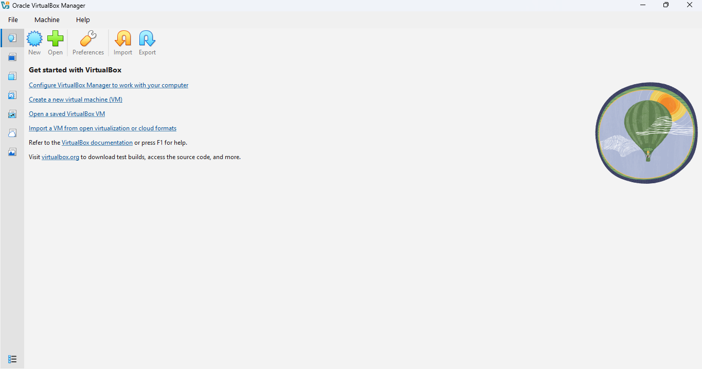
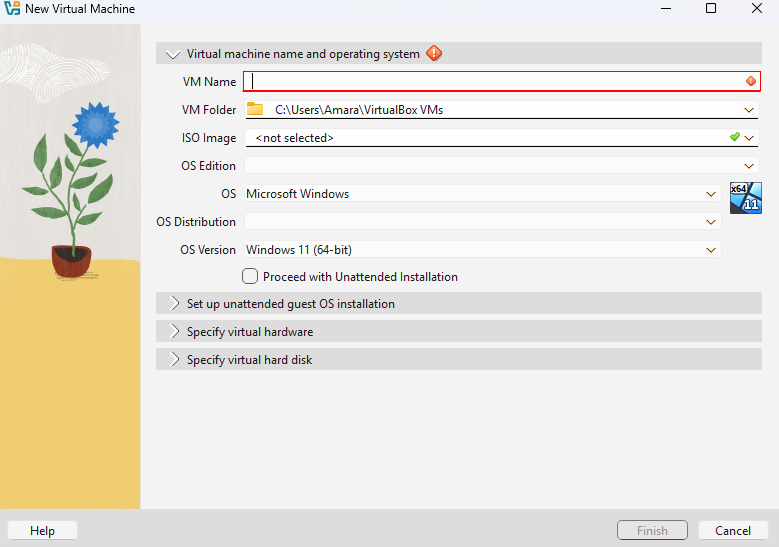
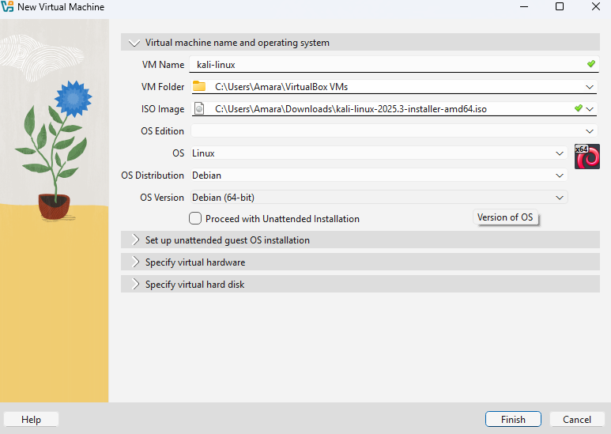
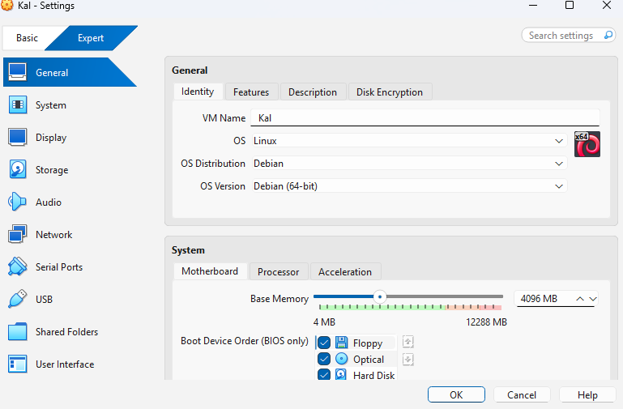
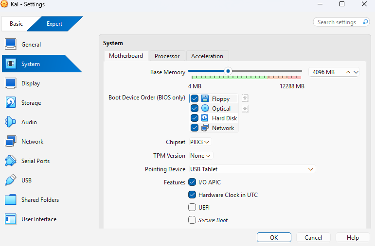
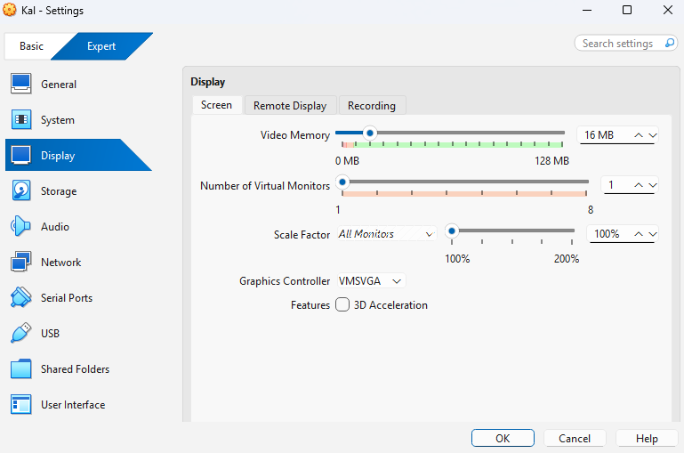
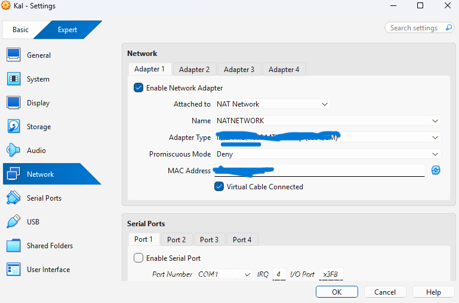
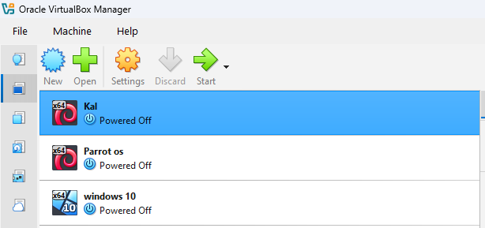

# CHINENYEPRECIOUS-B084-WK1-PM1 — Cybersecurity Lab Setup: VirtualBox and Kali Linux

**Project Category:** Cybersecurity | Virtualization | Linux | Ethical Hacking  
**Difficulty:** Beginner  
**Status:** Completed — Kali Linux starts successfully, and internet access works.

---

## 1. Project Overview

This project documents the setup, configuration, and testing of a cybersecurity learning environment using Oracle VirtualBox and Kali Linux.

The objective was to establish a virtual laboratory where I can practise Linux administration, explore cybersecurity tools, perform controlled security experiments, and develop practical skills in ethical hacking.

The project involved reviewing virtual machine settings, allocating system resources, configuring display and network settings, selecting the Kali Linux installation ISO, and verifying that the virtual environment works correctly.

## 2. Project Objectives

- Set up a virtual cybersecurity laboratory.
- Configure a Kali Linux virtual machine.
- Understand virtual machine hardware settings.
- Allocate appropriate memory and display resources.
- Configure network connectivity.
- Verify that Kali Linux starts successfully.
- Test internet connectivity.
- Document the setup process with screenshots.
- Prepare an environment for future cybersecurity and penetration-testing labs.

## 3. Tools and Technologies

| Tool | Purpose |
|---|---|
| Windows 10/11 | Host operating system |
| Oracle VirtualBox | Virtualization platform |
| Kali Linux | Linux-based penetration-testing operating system |
| Kali Linux ISO | Operating system installation image |

## 4. Downloading and Installing Oracle VirtualBox

Oracle VirtualBox is a free, open-source virtualization software that allows users to run multiple operating systems on one computer.

### Step 1: Visit the Official VirtualBox Website

I accessed the official Oracle VirtualBox website:

https://www.virtualbox.org/

### Step 2: Download VirtualBox

1. Navigate to the **Downloads** section.
2. Select **Windows hosts** under the VirtualBox platform packages.
3. Download the Windows installer to your computer.
4. Wait for the download to complete.

### Step 3: Install VirtualBox

1. Locate the downloaded VirtualBox installer in the Downloads folder.
2. Double-click the installer to launch the setup wizard.
3. Follow the installation instructions.
4. Accept the default installation options unless a specific change is required.
5. Allow the installation process to complete.
6. Click **Finish** to close the setup wizard.

### Step 4: Launch VirtualBox

After installation:

1. Open Oracle VirtualBox from the Windows Start menu or desktop shortcut.
2. Confirm that the VirtualBox Manager opens successfully.
3. The application is now ready for creating and managing virtual machines.

**Official Download Page:** https://www.virtualbox.org/wiki/Downloads

**Note:** Download VirtualBox only from the official Oracle website to avoid unofficial or modified installers.

## 5. Installation and Configuration Process

The following screenshots document the VirtualBox and Kali Linux setup process in a logical sequence.

### Step 1: Opening Oracle VirtualBox

I started by opening Oracle VirtualBox, the virtualization platform used to create and manage virtual machines.



### Step 2: Creating a New Virtual Machine

I reviewed the new virtual machine creation screen before proceeding with the required configuration.



### Step 3: Selecting the Kali Linux ISO

I selected the Kali Linux installer ISO:

`kali-linux-2025.3-installer-amd64.iso`

The virtual machine was configured to use Linux, Debian, and Debian (64-bit).



### Step 4: Configuring General Settings

I reviewed the virtual machine's general settings and confirmed Linux as the operating system type and Debian (64-bit) as the version.



### Step 5: Configuring System Resources

I allocated 4096 MB (4 GB) of RAM to the virtual machine to support the Kali Linux environment.



### Step 6: Configuring Display Settings

I reviewed the display configuration, including the VMSVGA graphics controller and 16 MB of video memory.



### Step 7: Configuring Network Settings

I enabled Adapter 1 and configured the network connection to use NAT Network with the network name `NATNETWORK`.



### Step 8: Reviewing VirtualBox Manager

Finally, I reviewed the VirtualBox Manager, which displayed the available virtual machines, including Kali, Parrot OS, and Windows 10.



## 6. Testing and Verification

After completing the setup, I confirmed that:

- Kali Linux starts successfully.
- Internet access is working.
- The virtual machine is ready for further cybersecurity practice.

The following Linux commands can be used to inspect network configuration and connectivity.

**Check network interfaces:**

```bash
ip address
```

**Check the routing table:**

```bash
ip route
```

**Test internet connectivity:**

```bash
ping -c 4 1.1.1.1
```

**Test DNS resolution:**

```bash
getent hosts kali.org
```

These commands help verify network interfaces, routing, internet connectivity, and DNS resolution.

## 7. Troubleshooting and Lessons Learned

During this project, I developed a better understanding of:

- Virtual machine configuration and management.
- RAM allocation and system resources.
- Virtual network adapter settings.
- NAT Network configuration.
- Selecting an operating system ISO.
- The relationship between a host operating system and a guest operating system.
- Basic network connectivity troubleshooting.

One important lesson was understanding how virtual network configuration affects internet connectivity within a virtual machine.

## 8. Future Improvements

The next stages of this cybersecurity laboratory will include:

- Installing and exploring essential Kali Linux security tools.
- Practising Linux commands and system administration.
- Setting up intentionally vulnerable machines for authorised testing.
- Performing basic vulnerability assessment exercises.
- Documenting practical cybersecurity lab activities.
- Building hands-on ethical hacking and defensive security projects.

## 9. Ethical Considerations

All future penetration-testing and security experiments will be conducted in authorised laboratory environments or on systems where permission has been granted.

The purpose of this project is learning, skill development, and responsible cybersecurity practice.

## 10. Official Resources

- [Oracle VirtualBox](https://www.virtualbox.org/)
- [Kali Linux Official Website](https://www.kali.org/)
- [Kali Linux Documentation](https://www.kali.org/docs/)
- [Kali Linux Downloads](https://www.kali.org/get-kali/)

## 11. Author

**Chinenye Precious Ubosi**

**Project Title:** Cybersecurity Lab Setup — VirtualBox and Kali Linux  
**Project ID:** CHINENYEPRECIOUS-B084-WK1-PM1

**Technologies:** Windows | Oracle VirtualBox | Kali Linux | GitHub

**Field:** Cybersecurity | Ethical Hacking | Virtualization
